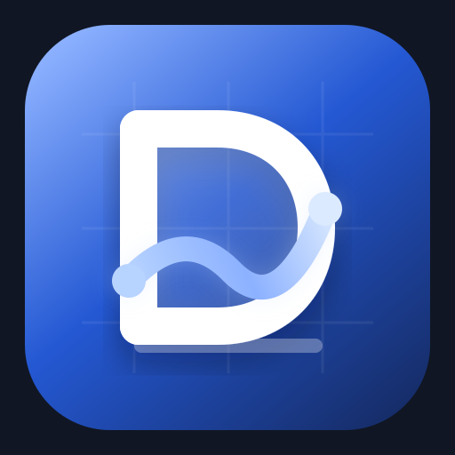
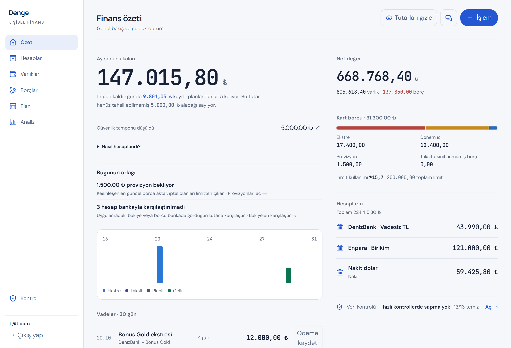
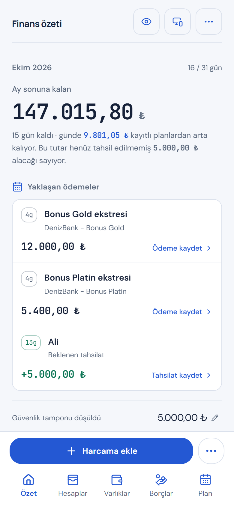
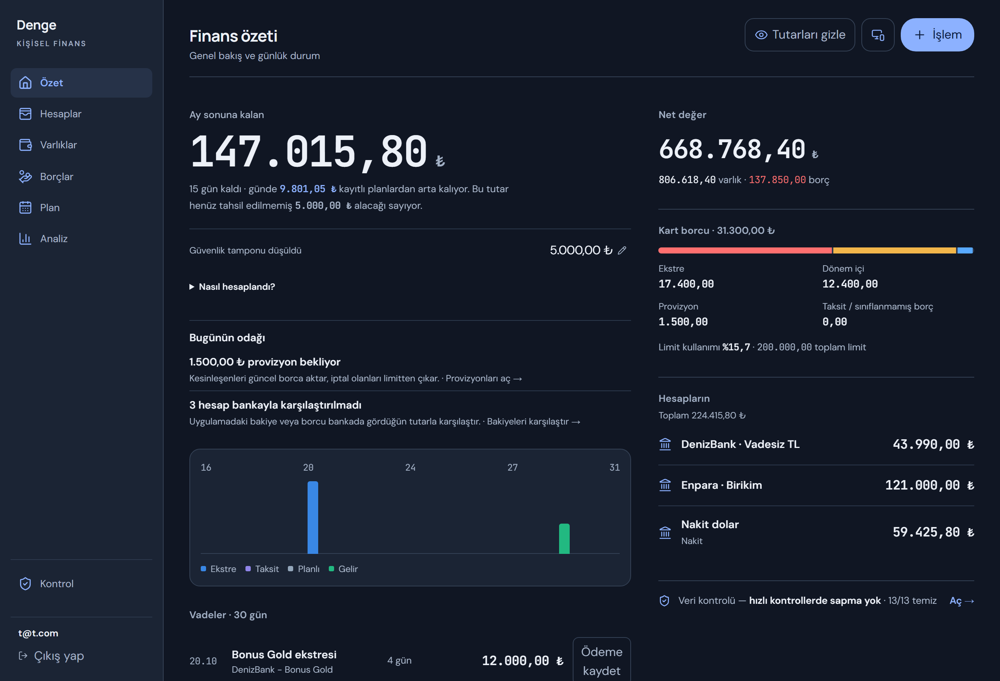
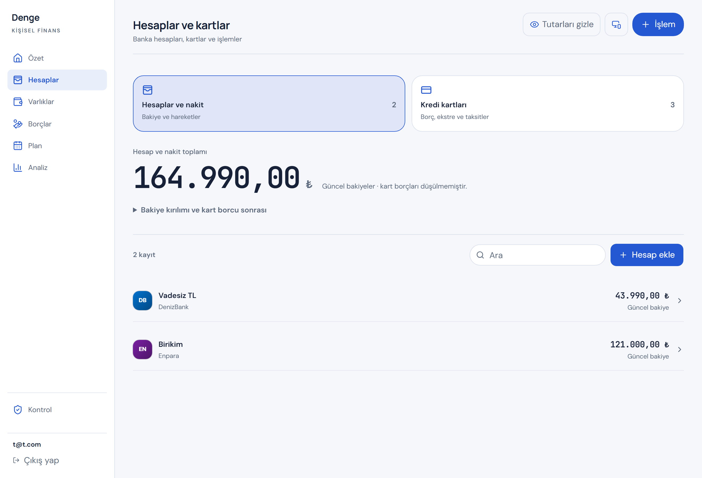
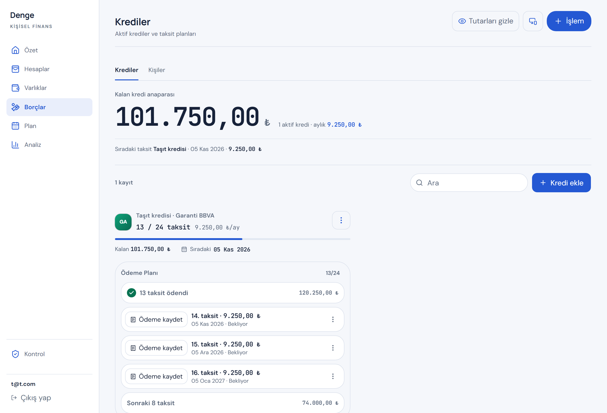
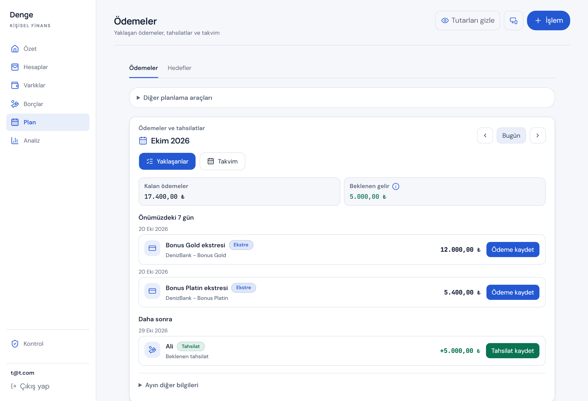
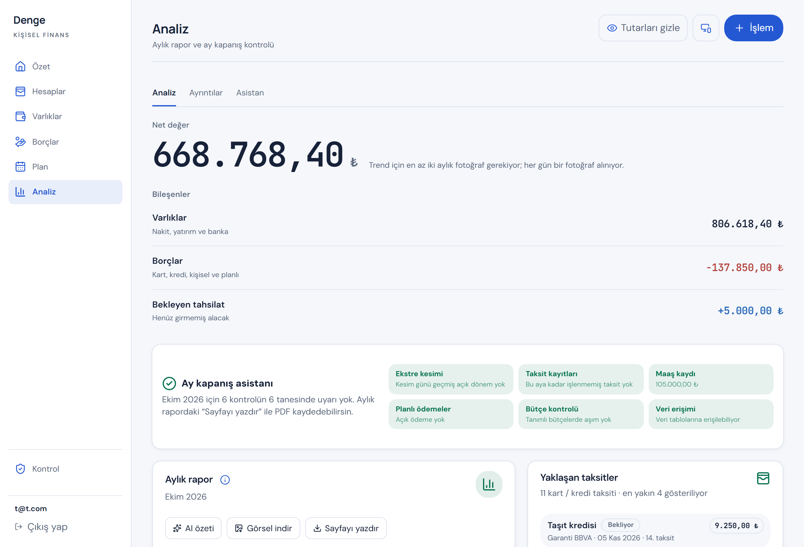
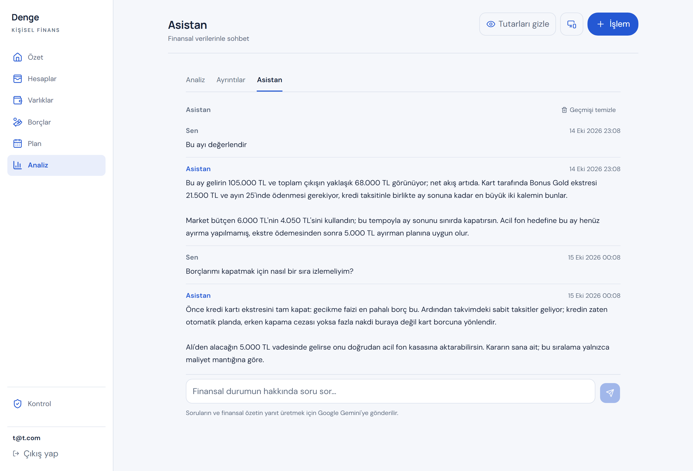
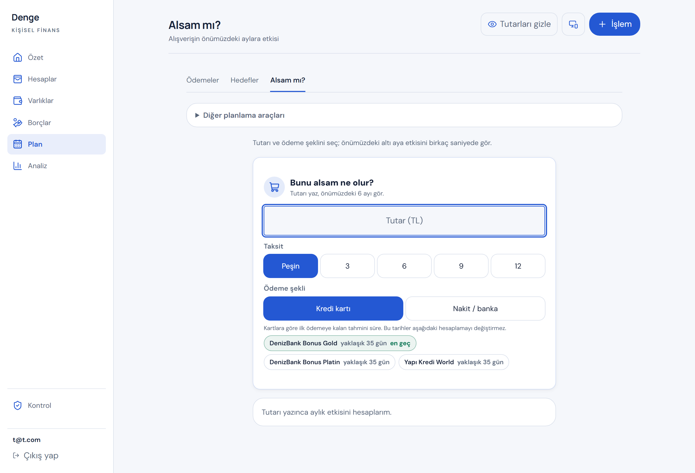

# Denge



**English** · [Türkçe](README.tr.md)

**A personal finance app that makes your monthly financial load visible before a due date slips past.**

Denge (Turkish for "balance") is a Turkish-language personal finance PWA that
brings cash, credit cards, loans, personal debts and planned payments together
in one place. The goal is not to keep a simple "income–expense list" but to
**show in advance what will leave your pocket this month and in the months
ahead** — before the statement closes, before the next installment, before the
payment day passes.

`React · TypeScript · Supabase · PWA` — single-user, Turkish lira, Turkish UI.



## What does it do?

The real challenge in personal finance is not individual purchases but
**seeing overlapping obligations in time**: the credit-card statement, card
installments, loan installments, debts to people and recurring payments all
land in the same month. Denge folds all of them into a single model and
answers one question:

> _"Am I balanced this month and the following ones — where, when and how much do I need to pay?"_

## Who is it for?

Denge is for people juggling **multiple bank accounts, credit cards and
installment plans** who want to see their cash balance ahead of time when
statement cuts, installment schedules and recurring payments stack up within a
month. In short, it targets single-person use looking for a clear answer to
_"what will leave my pocket this month and in the months ahead?"_ (Turkish
lira, Turkish UI).

**Who it is not for:** it is not designed for multi-user company bookkeeping,
team/role management, or multi-currency investment portfolio tracking.

## Features

- **Accounts & assets** — Bank accounts, cash and investment assets, salary
  history and gold tracking. Balances are event-sourced.
- **Credit card management** — Purchases, provisions (pending authorizations),
  statement cuts, installment purchases and mid-period payments. Debt is broken
  down into current-period / statement / provision buckets.
- **Loans & personal debts** — Loan installment plans plus debt/receivable
  tracking with people, complete with an installment calendar. A separate
  tracking-only list records payments that are not expected back and does not
  affect balances, debt or cash-flow projections.
- **Planning & payment calendar** — Upcoming payments, monthly cash-flow
  projection, budget alerts, savings goals and installment schedule summaries.
- **Analysis & net worth** — Net worth, wealth and cash-flow trends;
  transaction history.
- **AI Assistant** — Chat about your own financial data in Turkish
  (`/analiz/asistan`). Questions are sent to Google Gemini together with a
  compact summary generated from your current in-app data; history persists
  across devices.
- **Decision tools** — "Should I buy it?" (a purchase's impact on future
  months), shopping list (30-day cooling-off rule + "when can I buy it"),
  spending contexts (pet / event / project budgets).
- **Vehicles & TCO** — Per-vehicle expenses, fuel logging, reminders and a
  total-cost-of-ownership report card.
- **Data health & backup** — An audit surface that detects inconsistencies and
  offers safe correction flows (deterministic, ownership- and type-checked
  repairs); single-file JSON backup/restore, notification preferences.
- **PWA** — Installable to the home screen, offline shell, quick shortcuts
  (add expense, planned payments, analysis), light/dark themes, Web Push
  notifications.
- **Subscription matching** — See the matched billing month, bank date and
  actual amount. Monthly card instructions use automatic tracking; manually
  paid plans retain their payment action.

## Status

- **Stable (core):** accounts & assets, credit-card debt / statements /
  installments, loans, personal debts & receivables, payment calendar,
  analysis & net worth, data health, Web Push notifications (preferences +
  quiet hours).
- **Import & automation:** SMS processing uses a Supabase Edge Function;
  DenizBank and YapıKredi statement parsers run locally in the browser, with an
  optional AI fallback for unsupported statements. Whole-statement line-total
  validation uses two independent checksums calibrated on real statements
  (see `docs/BACKLOG.md`). The AI assistant is a recent addition (Gemini free
  tier).

## Visual language: Şerit / Ink and Sapphire

The UI uses the **Şerit** ("stripe") visual language introduced with the
2026-08 redesign: rows separated by hairlines instead of stacked shadowed
boxes, a single hero number per screen, mono + tabular numerals for financial
figures; a card only where a block earns one. Since 16 October 2026, the color
identity is **Ink and Sapphire (Mürekkep ve Safir)**: cool light surfaces,
ink/navy dark surfaces and sapphire primary actions. Green marks positive
financial movement and success. The app follows the system theme and supports
manual light/dark selection.

On phones, upcoming due dates appear near the main balance, a labeled expense
action sits above navigation, and the expense form puts account, amount,
description and save first. Payments offers Upcoming/Calendar views of the
same obligations. Accessible icon labels, wrapped text and reduced-motion
support are part of the shared design. Rules:
[`docs/UI_ARCHITECTURE.md`](docs/UI_ARCHITECTURE.md) (Turkish).

## Screenshots

> The screenshots below were taken in a local development environment with
> **representative demo data**, refreshed on 16 October 2026. No production
> account or financial data is used. [Capture details](docs/screenshots/README.md).

| Phone overview | Dark theme |
| --- | --- |
|  |  |

| Accounts & cards | Loans & installments |
| --- | --- |
|  |  |
| **Payment calendar** | **Analysis & month close** |
|  |  |
| **AI Assistant** | **Should I buy it?** |
|  |  |

## Privacy & security

> - Finance records are stored in **your own Supabase project**. Using the AI
>   assistant sends your question and a financial summary to Google Gemini;
>   AI receipt/statement parsing sends the selected content through an Edge Function.
> - Row Level Security (RLS) on every table: every row is scoped by
>   `user_id = auth.uid()`.
> - Only the **anon key** ever reaches the client; the **service role** key is
>   never shipped to it.
> - Frontend filtering is never trusted — authorization is enforced in the
>   database.

## Money model (the foundation of trust)

The most critical thing in a finance app is monetary precision. Denge stores
money as `numeric` in the database and as **signed integer kuruş** (the Turkish
cent) in the ledger tables; every rounding/comparison on the JS side goes
through a single core (`src/utils/money.ts`). The big monetary figures — card
debt, bank balance, loan summary, card-debt breakdown — are either derived
from events or protected by database triggers at write time, so inconsistency
becomes mathematically impossible. Corrections never rewrite history; they are
appended as **reversal entries** (append-only).

## Architecture

Layer boundaries are enforced with ESLint; the UI can never see Supabase
directly:

```
domain   → src/utils/*              Pure calculation/business rules. Heavily tested.
data     → src/data/repositories/*  The only Supabase contact. Returns Result<T>.
app      → src/app/*                TanStack Query use-case hooks.
ui       → src/pages, components    "Dumb" presentation layer.
services → src/services/*           RPC wrappers.
lib      → src/lib/*                supabase client, error logging, external clients.
```

**Tech:** React 19 · TypeScript · Vite 7 · Tailwind CSS v4 · TanStack Query ·
React Router v8 · Supabase (Postgres + Auth + Edge Functions) · Google Gemini
(receipt/statement parsing + AI assistant, edge-only) · Vercel (+ Analytics) ·
PWA.

There is no remote error-tracking service (Sentry was removed on 2026-08-19):
crashes and errors are tracked in-app via `AppErrorBoundary` plus a dedicated
`client_errors` table under RLS.

## Getting started

```bash
npm ci

npm run dev            # Connects to production Supabase (.env.local required)
npm run dev:local      # Local Supabase (docker) + Vite — never touches production
npm run dev:local:stop # Stops the local Supabase docker
npm run db:seed:local  # Resets the local DB + loads demo data
```

1. Create a Supabase project (or use `npm run dev:local` for local
   development).
2. Apply the migrations under `supabase/migrations/*` with the CLI.
3. Copy `.env.example` to `.env.local` and fill in the values:
   - `VITE_SUPABASE_URL`
   - `VITE_SUPABASE_ANON_KEY`

Local demo login: `t@t.com / password123` (run `npm run db:seed:local` first;
valid only on the local docker).

Before calling a change "done" (the exact local mirror of the CI quality gate —
lint + tests with coverage + dependency audit + build + bundle budget + edge
type check):

```bash
npm run verify
```

For an end-to-end smoke test, `npm run test:e2e` (Playwright) can be run
separately.

For quicker local feedback, `npm run test:changed` runs repository guards plus
tests affected by changes against the local `origin/main` ref. Keep that ref
current. It does not replace `verify`: full unit/coverage commands and CI still
require all tests and the Node-based file guards (`npm run test:guards`).

## Deploy

A merge into protected `main` starts production deployment (GitHub Actions →
Vercel). Lint, coverage and dependency audit run in parallel with the single
production build and staged upload. The required **Lint and Build** check
aggregates both results. CLI/lint/TypeScript caches reduce repeated work;
Lighthouse starts when the PR build is ready.

Required database and edge checks must succeed before release; migrations
require an encrypted backup. The staged artifact is promoted after all required
gates pass, with automatic frontend rollback when the production `/login` smoke
fails. Each workflow includes a duration report. Details:
[`docs/PIPELINE.md`](docs/PIPELINE.md) (Turkish).

Runtime loading, cache freshness and measured navigation improvements:
[`docs/APP_PERFORMANCE.md`](docs/APP_PERFORMANCE.md) (Turkish).

## Contributing & AI agents

This repository is documented for working with AI agents (Claude Code, Codex).
When starting a session, read
[`docs/AI_CONTEXT_INDEX.md`](docs/AI_CONTEXT_INDEX.md) first — it gives the
cheapest task-based reading route and the topic→file table. The canonical
rules live in [`CLAUDE.md`](CLAUDE.md), and the domain + table + route map in
[`docs/PROJECT_CONTEXT.md`](docs/PROJECT_CONTEXT.md). Project documentation is
in Turkish.

## License

[MIT](LICENSE) © Enes Garip
